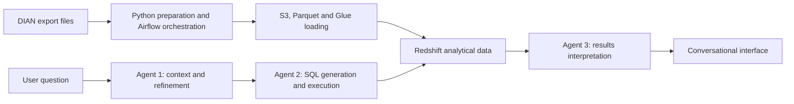

# Code Sample NLP

**Nathaly Henao Lugo · Applied NLP and conversational data systems**

This repository shares selected code from a collaborative master's project combining an automated export-data pipeline with a multi-agent chatbot. The chatbot analyzes natural-language questions, collects analytical parameters, prepares database queries and explains results for nontechnical users.

The sample contains **eight methods selected from the original chatbot source and selected instructions from its three agents**. It presents the larger project's architecture while keeping the full application, institutional records and infrastructure separate. See the [source map](docs/SOURCE_MAP.json) for original file names, method ranges and source hashes.

## The project and my contribution

The project addressed a practical analytical problem at the Cámara de Comercio de Cali: making historical Colombian export data easier to prepare, update and query. It connected two phases:

1. **Data preparation and automation:** inspect historical files, identify variables, standardize records and coordinate monthly ingestion and storage using Python, Apache Airflow and AWS services.
2. **Conversational analytical access:** use pretrained language models and specialized agents to understand user requests, gather missing context, translate requests into SQL and present understandable answers.

I worked across both phases, including the data workflow, the chatbot's agents and their integration. The original research was conducted jointly with **Alejandro Perez Lugo and Mauricio Guzmán Arango**. The sample preserves that joint authorship and describes my participation without claiming sole ownership of the project.

## What demonstrates NLP and text analysis

The text being analyzed is the user's question. The project combines LLM-based interpretation with explicit context-handling and query-shaping code:

| Capability | Evidence in this sample |
| --- | --- |
| Configurable language-model instructions | Original prompt-construction method and selected configurations for three agents |
| Interpretation of analytical intent | Original detection of totals, averages, rankings and grouping dimensions |
| Structured meaning for database queries | Original helpers map wording onto query type, grouping column and ranking size |
| Conversational context | Original context builder assembles previous turns for the first agent |
| Clarification before progression | Original response-marker detection determines whether more input is needed |
| Results communication | Selected original analyst-agent instructions require use of the supplied SQL results |

The original system applied pretrained LLMs through AWS Bedrock. The code sample does not claim that I trained a foundation model or that prompts guarantee factual correctness. The original lexical rules primarily recognize Spanish phrasing, as reflected in the retained search vocabulary.

## How the complete project fits together



The [project brief](docs/PROJECT_BRIEF.md) explains the broader workflow and the [review notes](docs/RESEARCH_NOTES.md) explain the selected code and its limits. This repository exposes representative language-processing components rather than the entire platform.

## Code reading guide

| File | Origin and purpose |
| --- | --- |
| [analysis.py](nlp_sample/analysis.py) | Five original `AgentCore` methods: configuration loading, prompt construction, model invocation, intent detection and grouping detection |
| [workflow.py](nlp_sample/workflow.py) | Three original `ConversationSystem` methods: initialization, history construction and clarification detection |
| [context configuration](prompts/context.txt) | Selected original instructions for the query-refinement agent; JSON stored as a text file |
| [SQL agent configuration](prompts/sql_agent.json) | Selected original instructions linking validated parameters and natural-language intent to SQL |
| [analyst configuration](prompts/analyst_agent.json) | Selected original instructions for explaining supplied query results |
| [source map](docs/SOURCE_MAP.json) | Method-level provenance and the exact selected instruction indices |

The selected methods retain the original control flow and identifiers. Comments were omitted, formatting was normalized, and docstrings, diagnostic messages and prompt presentation text were translated to English. Spanish database identifiers, protocol markers and matching vocabulary remain for compatibility. The source-selection process checked the published methods against the original syntax trees after reversing those text translations.

## Inspect and run the selected helpers

With Python 3.11 or later, run from the repository root:

```sh
python -m nlp_sample
python -m unittest discover -s tests -v
python scripts/check_publication.py
```

The local demonstration invokes the **original intent/grouping helpers** on an illustrative question such as `top 5 productos en 2024`, builds conversational context and exercises the original model-invocation method with a visibly labeled test double. It makes no AWS, database or language-model call. It reports the helpers' actual computed outputs, not export statistics or a simulated research score.

The entry point, small logging adapter and tests are review scaffolding added around the selected source; they are identified as such. The complete SQL executor and the full conversation `process` method are deliberately outside the excerpt, so this is not a replacement for the complete application.

## Examples and evidence

[Illustrative questions](data/questions.jsonl) describe how a reviewer might examine the workflow. They are newly written, synthetic inputs, not institutional conversations or captured model predictions. No trade totals, model-accuracy percentage or benchmark result is asserted.

The tests exercise the selected code using controlled inputs and test doubles. They check implementation behavior and excerpt integrity, not language-model quality. GitHub Actions runs the checks on Python 3.11, 3.12 and 3.13. Broader NLP evaluation would require independently labeled questions, actual model runs and a separate evaluation protocol.

## Authorship and access

See [NOTICE.md](NOTICE.md) for joint authorship and the distinction between original source and later editorial packaging. The full thesis, full project source, real datasets, credentials and deployment settings are excluded. The repository remains private for academic review. No open-source license has been selected; please contact the authors before redistribution or reuse.
