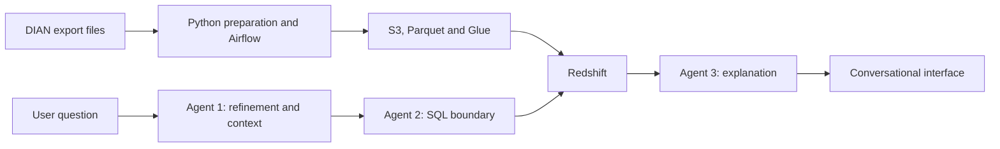

# Code Sample NLP

**Nathaly Henao Lugo · Applied NLP and conversational data systems**

This sample comes from a collaborative master's project that combined an automated Colombian export-data pipeline with a multi-agent chatbot. The aim was to help analysts ask questions in natural language, refine incomplete requests and obtain understandable responses from an analytical database.

I worked across data preparation, workflow automation, the conversational agents and their integration. The original research was conducted jointly with **Alejandro Perez Lugo and Mauricio Guzmán Arango**. This repository presents selected original implementation work in English for academic review, while keeping the complete platform and institutional materials separate.

## Read the code as one workflow

Start with the actual conversation controller, then inspect the components it calls:

1. **[workflow.py](nlp_sample/workflow.py), `ConversationSystem.process`:** add the user's turn to history, build context, call the refinement agent, pause for missing information, hand off to Agent 2 and pass its response to Agent 3.
2. **[analysis.py](nlp_sample/analysis.py), `AgentCore.invoke` and `_build_prompt_from_json`:** construct role-specific instructions and invoke a supplied language-model interface.
3. **[analysis.py](nlp_sample/analysis.py), `_analizar_contexto` and `_detectar_agrupacion`:** inspect the original lexical helpers for rankings, averages and grouping dimensions.
4. **[Agent configurations](prompts):** inspect selected original instructions for refinement, SQL work and results explanation.
5. **[Worked example](docs/WALKTHROUGH.md):** follow two conversation turns and see precisely which steps come from original code, scripted fixtures and the excluded private SQL boundary.

The sample contains **ten original methods** from two source files. Their control flow and compatibility identifiers are preserved; comments were omitted and selected presentation strings were translated. Formatting was expanded for readability. The [source map](docs/SOURCE_MAP.json) records original file ranges, hashes and selected instruction indices. Added review tools and the explicit SQL-exclusion guard are identified separately.

## The larger project

The full project connected two phases: Python/Airflow preparation of historical export records, and an LLM-based interface to the resulting analytical data. Its architecture used S3, Parquet, Glue and Redshift alongside the chatbot. The [project brief](docs/PROJECT_BRIEF.md) explains the wider work and its engineering decisions.



## What the text analysis does

The text being analyzed is the user's analytical question. The original system combines pretrained language-model interpretation with explicit workflow code and lexical query-shaping helpers.

| Part | Responsibility | Evidence to inspect |
| --- | --- | --- |
| Refinement agent | Interpret the question, gather period/metric/filters and request confirmation | Selected prompt instructions and the model-invocation boundary |
| Context builder | Present previous turns to the refinement agent | `_construir_contexto_agent1` |
| Intent helpers | Identify ranking/average cues and grouping dimensions | `_analizar_contexto`, `_detectar_agrupacion` |
| Conversation controller | Decide whether to pause or transfer outputs to later agents | `process`, `_agent_necesita_input` |
| Analyst agent | Explain the supplied SQL output | Selected analyst instructions and the controller's handoff |

The prompt describes intended model behavior; the controller determines what happens with its returned text. A prompt is not evidence that the model interpreted a question correctly. The original lexical helpers mainly recognize Spanish phrases; they do not provide general language understanding.

## A concrete example

The worked example starts with `Quiero el top 5 de productos por valor FOB.` and then `2024. Sí, confirmo.` The first turn pauses before SQL; the confirmed turn transfers the first agent's response to the SQL boundary, then supplies that boundary's payload to the analyst. Completion records the conversation and clears its active context.

The [walkthrough](docs/WALKTHROUGH.md) explains this sequence without requiring the reader to run anything. For a reproducible control-flow check, the review harness supplies explicitly scripted model responses and a SQL contract placeholder. **It makes no live model or database calls and reports no trade findings.** The fixture verifies routing and state, not model quality or database correctness.

## Decisions, limitations and research questions

The implementation separates refinement, SQL work and explanation. That makes responsibilities inspectable, while introducing questions about model-output contracts, ambiguity and error propagation.

Four executed diagnostic examples reveal limits in the unchanged lexical helpers: a department ranking can map to products; averaging can lose the country grouping; `primeros 5` can default to 10; and a negated ranking can be treated as affirmative. The [review notes](docs/RESEARCH_NOTES.md) explain these cases and distinguish observed behavior from intended interpretations. They are retained as limitations, not presented as solved problems or a benchmark score.

## Optional reproducibility checks

Python 3.11 or later; standard library only:

```sh
python -m nlp_sample
python -m nlp_sample --limits
python -m unittest discover -s tests -v
python scripts/check_publication.py
```

The **18 tests** cover excerpt integrity, clarification, context retention, exact handoff, completion, controlled errors and documented language limitations. Passing these checks establishes those software behaviors, not semantic NLP accuracy. CI runs on Python 3.11, 3.12 and 3.13.

## Authorship and scope

The original code is distinguished from later English documentation, fixtures and review checks in [NOTICE.md](NOTICE.md). Full ingestion/deployment code, the private SQL executor, the thesis document, institutional records and credentials are excluded. The repository remains private for academic review. No open-source license has been selected; please contact the authors before redistribution or reuse.
