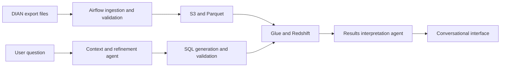

# Code Sample NLP

**Nathaly Henao Lugo · Applied natural language processing and end-to-end data systems**

This repository presents selected code and research context from a collaborative master's project: an automated export-data platform with a conversational, multi-agent interface. It demonstrates how natural-language questions become structured analytical requests, validated database queries and understandable answers.

The broader project connects data preparation and workflow orchestration with LLM-based language understanding. This sample makes the language-analysis and reasoning workflow easy to inspect and run, while presenting the architecture and methodology of the complete project. The full application and infrastructure remain in a separate private repository.

## Research and project context

The project addressed a practical problem: analysts needed to explore historical Colombian export records without manually combining spreadsheets or writing every SQL query. The work covered two connected phases:

1. **Data engineering:** inspect heterogeneous historical files, define a consistent schema, validate and transform records, automate monthly ingestion with Apache Airflow, and integrate S3, Glue and Redshift.
2. **Applied NLP:** interpret user questions, collect missing context, extract analytical parameters, translate validated requests into SQL, and explain query results through a coordinated agent workflow.

I contributed across both phases, including data preparation and automation, the conversational agents and their integration with the analytical workflow. The original research was conducted jointly with **Alejandro Perez Lugo and Mauricio Guzmán Arango**. See [authorship and provenance](NOTICE.md).

## Natural language processing and text analysis

The text being analyzed is the user's analytical question. The language-processing tasks include:

| Task | What the system needs to understand |
| --- | --- |
| Intent interpretation | Whether a user requests a total or a ranking |
| Information extraction | Period, metric, destination and ranking size |
| Semantic normalization | Map surface wording onto an explicit analytical schema |
| Ambiguity handling | Ask for clarification instead of inventing missing parameters |
| Conversational context | Resolve an explicit follow-up against the previous request |
| Semantic parsing | Convert the validated meaning into a database operation |
| Grounded response generation | Explain only the results supplied by the query |

The original system used pretrained LLMs through AWS Bedrock and an AgentCore-oriented deployment. This is experience applying language models and designing their surrounding workflow; it does not claim training a new foundation model.

Text-to-SQL is an established semantic-parsing task in NLP; see [Deng et al., COLING 2022](https://aclanthology.org/2022.coling-1.190/). This project focuses on conversational analytical questions. Corpus-level document classification, topic modeling and sentiment analysis are outside the demonstrated task.

## Explore the sample

**Python 3.11 or later. The offline demo uses only the standard library.** After cloning the repository, run from its root:

```sh
python -m nlp_sample
```

Or try one question:

```sh
python -m nlp_sample "What was the FOB value of exports to Chile in 2023?"
```

The result includes the extracted meaning, SQL with bound parameters, synthetic rows and an answer:

```json
{
  "start_year": 2023,
  "end_year": 2023,
  "metric": "fob_usd",
  "operation": "total",
  "destination": "Chile",
  "top_k": 5
}
```

The synthetic answer is **150,000.00 USD**. In the default multi-turn demo, “Now for 2024?” preserves the metric and destination and returns **195,000.00 USD**. Every displayed amount comes from 14 invented records supplied with this repository.

The local version uses a **transparent rule-based reference analyzer created for this sample**. It performs real text analysis within a limited vocabulary. A separate `ModelAnalyzer` accepts a caller-supplied language-model function and validates structured output. The default demo and reported evaluation make **zero model calls**. The rule baseline and SQLite backend are new demonstration components; they are not presented as the original thesis's LLM or Redshift implementation.

## How the complete project fits together



The sample provides a small executable path through the language-analysis, query and answer stages. The [project brief](docs/PROJECT_BRIEF.md) explains the wider system and the engineering decisions. The [research notes](docs/RESEARCH_NOTES.md) describe evaluation, limitations and further experiments.

## Code reading guide

| File | What to inspect |
| --- | --- |
| [analysis.py](nlp_sample/analysis.py) | Semantic representation, normalization, extraction, abstention and the LLM boundary |
| [workflow.py](nlp_sample/workflow.py) | Conversation state, bounded query construction and evidence-based answers |
| [context prompt](prompts/context.txt) | Instructions separating language interpretation from database execution |
| [evaluate.py](nlp_sample/evaluate.py) | Exact semantic comparison, field accuracy, decision errors and category results |
| [questions.jsonl](data/questions.jsonl) | Synthetic reference cases, including ambiguity and difficult paraphrases |
| [tests](tests/test_sample.py) | Behavioral checks for context isolation, invalid model output and query execution |

## Reproduce the evaluation

```sh
python -m unittest discover -s tests -v
python -m nlp_sample.evaluate --check
python scripts/check_publication.py
```

The checked-in [evaluation report](reports/evaluation.json) records **32 exact matches out of 36 synthetic cases (88.89%)** for the offline rules. Four difficult paraphrases produce clarification instead of a complete extraction. Every prediction and reference label is retained, including the failures. These are diagnostic examples authored alongside the sample, not an independently held-out benchmark or a measurement of the thesis's LLM accuracy.

The regression suite checks software behavior; the diagnostic corpus checks text interpretation. Passing one does not establish the other. GitHub Actions runs the tests, demo, report-reproduction check and publication scan on Python 3.11, 3.12 and 3.13.

## Scope and access

Included material is intentionally sufficient to understand the overall project and review representative NLP code. The original ingestion implementation, deployment configuration, full database schema, institutional records, thesis document and cloud credentials are outside this repository. A fresh history keeps those materials separate.

The repository is prepared for private academic review. No open-source license has been selected. Please preserve the joint authorship and contact the authors before redistributing or reusing the material.
